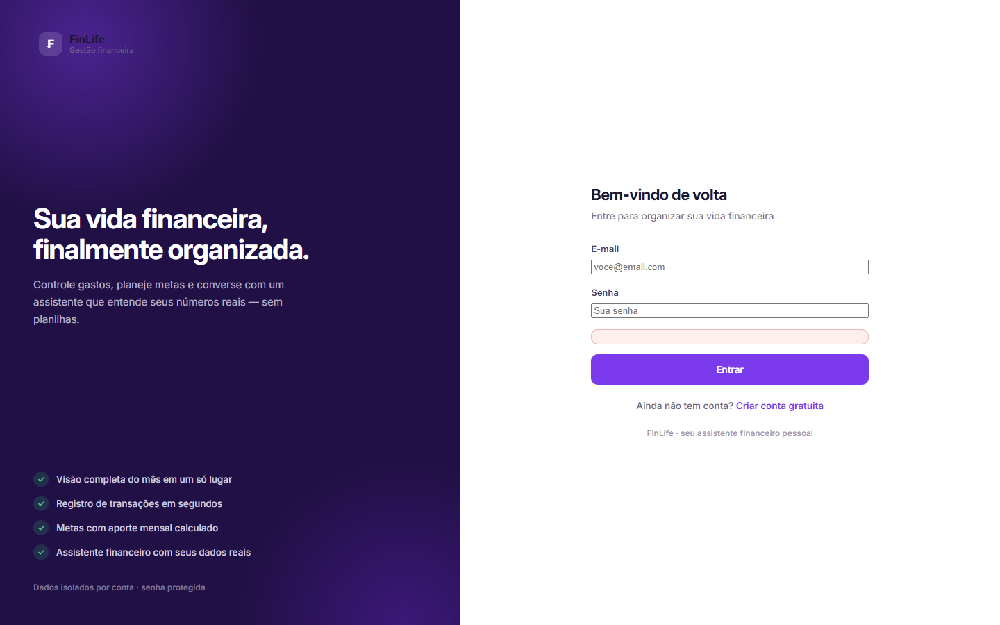

<div align="center">
  <h1>FinLife</h1>
  <p><strong>Organização de finanças pessoais em PHP, MySQL e JavaScript.</strong></p>
  <p>
    <a href="https://finlife.spssolar.com.br/login"><strong>▶ Ver demonstração</strong></a>
    ·
    <a href="#funcionalidades"><strong>Funcionalidades</strong></a>
    ·
    <a href="#como-executar"><strong>Executar localmente</strong></a>
  </p>
</div>

---

FinLife é uma aplicação web para registrar receitas e despesas, acompanhar contas, categorias, metas, cartões e compromissos e visualizar indicadores financeiros. O frontend consome endpoints HTTP/JSON separados por responsabilidade, enquanto a persistência e as regras de negócio ficam em PHP e MySQL.

> **Status:** projeto em evolução. A demonstração pública permite criar uma conta de teste. O módulo de mercado consulta APIs públicas de terceiros e informa provedor, horário e situação do cache; não representa conexão com Open Finance ou com o sistema bancário do usuário.

## Demonstração

- **Aplicação:** <https://finlife.spssolar.com.br/login>
- **Cadastro local:** disponível em `/cadastro`

A demonstração é a tela de entrada da aplicação. Para avaliar as áreas protegidas, crie uma conta local ou de teste; não versione dados pessoais.

<div align="center">
  
</div>

## Funcionalidades verificadas no código

### Gestão financeira

- cadastro, login, logout e sessão autenticada;
- receitas e despesas vinculadas a contas e categorias;
- contas com saldo inicial, tipos e associação opcional de instituição;
- categorias padrão e personalizáveis por usuário;
- metas com valor-alvo, prazo, status e aportes;
- dashboard com saldo, receitas, despesas, taxa de poupança, orçamento mensal, evolução e categorias;
- orçamento mensal e indicadores de uso.

### Cartões e compromissos

- cartões de crédito, débito, benefício e múltiplo, com limite, vencimento e conta associada;
- compras, faturas, parcelamentos, pagamentos e compras recorrentes;
- linha do tempo e regras de lançamento para crédito, débito e benefícios;
- compromissos e contas fixas, ocorrências e pagamentos;
- alertas de limite e visão consolidada de vencimentos.

### Mercados e portfólio

- visão geral de índices, câmbio e cripto;
- cotações, histórico, busca, maiores altas/quedas, notícias, watchlist e alertas;
- provedores públicos com fallback e cache por classe de ativo;
- identificação de dado fresco ou antigo (`is_stale`), fonte e horário;
- carteira de investimentos, ativos, passivos, dividendos e transações de portfólio.

### Assistente FinLife AI

- interpretador local de linguagem e confirmação antes de ações que alteram dados;
- integração opcional com API compatível com `chat/completions` (OpenAI, DeepSeek, Groq ou OpenRouter);
- contexto construído a partir dos dados reais do usuário no banco;
- histórico de conversa e confirmação explícita para criar transações ou metas.

## Tecnologias utilizadas

| Tecnologia | Função no projeto |
|---|---|
| **PHP 8.1+** | rotas, controllers, regras de negócio e APIs HTTP/JSON |
| **MySQL / MariaDB** | persistência relacional, isolamento por usuário e cache de market data |
| **PDO** | conexão e prepared statements |
| **JavaScript** | consumo assíncrono das APIs, formulários, gráficos e interações |
| **HTML5 / CSS3** | interfaces responsivas com tema escuro |
| **SVG e Canvas** | gráficos próprios do dashboard e do módulo de mercados, sem biblioteca externa |
| **Apache ou servidor embutido do PHP** | execução local e em hospedagem |
| **Git / GitHub** | versionamento e organização do código |

## Arquitetura e organização

```text
api/             Endpoints HTTP/JSON (autenticação, finanças, cartões, mercados...)
config/          Configurações da aplicação e do provedor de IA
controllers/     Renderização server-side das páginas
core/            Autenticação, banco, validação e rate limiting
includes/        Bootstrap, leitura de ambiente e helpers
models/          Regras de negócio e acesso aos dados
services/        IA, contexto, processamento de linguagem e integração com provedores
services/market/ Provedores, cache e normalização de dados de mercado
public/          Front controller, CSS, JavaScript, fontes e imagens
views/           Views PHP por área da aplicação
scripts/         Instalação do banco e scripts de verificação
database.sql     Schema completo, sem dados pessoais
```

O fluxo principal é: **navegador → API/Controller → Model → MySQL**. As views carregam o shell da página; dados protegidos são obtidos por `fetch` nas APIs. Um autoloader simples evita dependências externas de PHP.

## Banco de dados

O arquivo [`database.sql`](database.sql) cria **31 tabelas** para usuários, contas, categorias, transações, metas, cartões, faturas, compromissos, conversas de IA, limites de requisição, dados de mercado e portfólio.

- relacionamentos usam chaves estrangeiras e `ON DELETE CASCADE` onde aplicável;
- dados pessoais são isolados por `user_id`;
- consultas de aplicação usam prepared statements;
- cotações e históricos são cacheados no próprio MySQL;
- o schema contém apenas estrutura: nenhum dado de usuário é versionado.

O instalador executa o schema de forma idempotente:

```bash
php scripts/install.php
```

## Como executar

### Requisitos

- PHP 8.1 ou superior com `pdo_mysql`, `curl`, `mbstring` e `session`;
- MySQL 5.7+/8 ou MariaDB compatível;
- Apache do XAMPP ou o servidor embutido do PHP;
- nenhuma dependência de frontend ou gerenciador de pacotes é necessária.

### 1. Configurar o ambiente

```bash
cp .env.example .env
```

Edite `.env` com os dados do seu MySQL:

```dotenv
DB_HOST=127.0.0.1
DB_PORT=3306
DB_NAME=finlife
DB_USER=root
DB_PASS=sua_senha_local
```

O `.env` está no `.gitignore`. A configuração da IA é opcional; sem `AI_API_KEY`, o assistente funciona no modo local.

### 2. Criar o banco e as tabelas

```bash
php scripts/install.php
```

### 3. Iniciar a aplicação

**Com XAMPP/Apache:**

1. copie o projeto para `htdocs/FinLife`;
2. ative Apache e MySQL;
3. abra <http://localhost/FinLife/>.

**Com o servidor embutido do PHP:**

```bash
php -S 127.0.0.1:8090 -t public router.php
```

Acesse <http://127.0.0.1:8090/> e crie uma conta em `/cadastro`.

## Segurança aplicada

- senhas com `password_hash()` e verificação/rehash de bcrypt;
- sessão HttpOnly, SameSite, expiração por inatividade e regeneração de ID;
- token CSRF em operações que alteram estado;
- prepared statements e validação de entrada;
- escape de saída HTML no servidor e no JavaScript;
- rate limiting em autenticação, cadastro, IA, transações e mercado;
- isolamento dos dados por usuário;
- chaves de IA e credenciais mantidas no backend;
- bloqueio de acesso direto a arquivos internos por `.htaccess` e `router.php`.

## Aprendizados demonstrados

- modelagem de dados relacionais e regras de negócio separadas das rotas;
- construção de APIs HTTP/JSON consumidas por JavaScript;
- autenticação, autorização por usuário e defesa contra erros comuns de segurança web;
- integração com provedores externos, fallback, cache e transparência sobre a idade do dado;
- organização de uma aplicação PHP sem framework e sem etapa de build.

## Próximas melhorias

- ampliar a suíte de testes automatizados e a cobertura de integração com o banco;
- evoluir o instalador e as migrações para ambientes versionados;
- revisar o módulo de mercados conforme os limites e termos de cada provedor;
- incluir documentação de contrato da API e testes de contrato;
- substituir gradualmente scripts auxiliares de auditoria por uma suíte de manutenção reproduzível.

## Segurança e privacidade

- `.env`, arquivos de log e dependências locais não devem ser versionados;
- não use dados reais de clientes em commits, issues ou capturas de tela;
- o repositório inclui apenas schema, código e documentação.

---

<div align="center">
  <sub>Projeto de código aberto para demonstração de desenvolvimento web e boas práticas de segurança.</sub>
</div>
